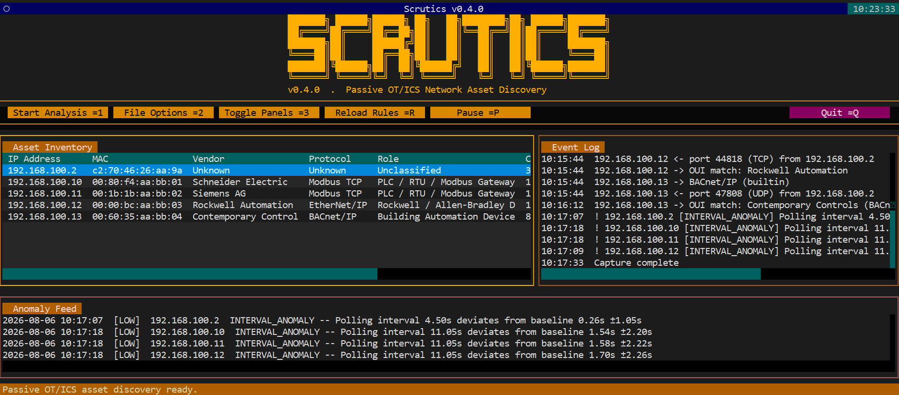
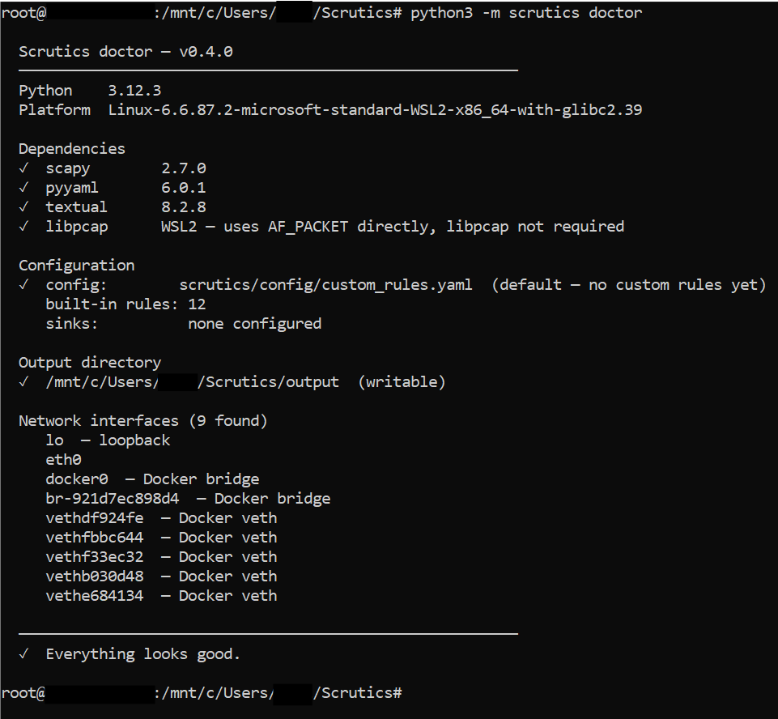
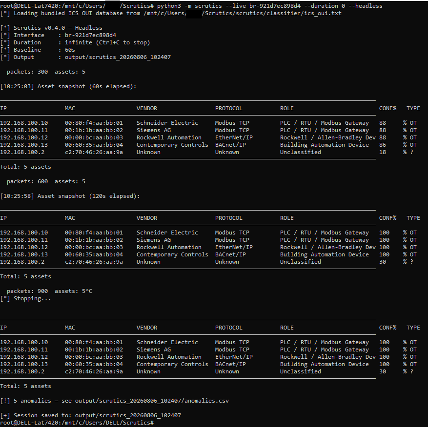
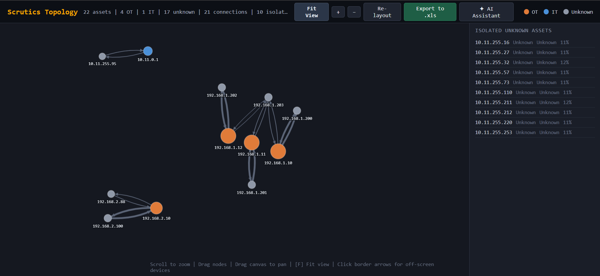
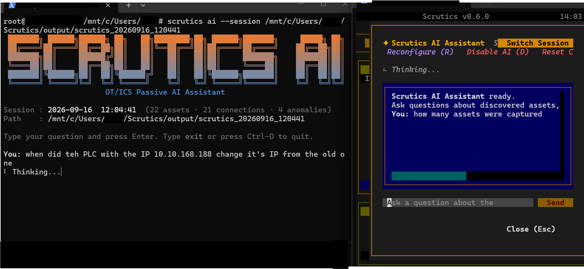
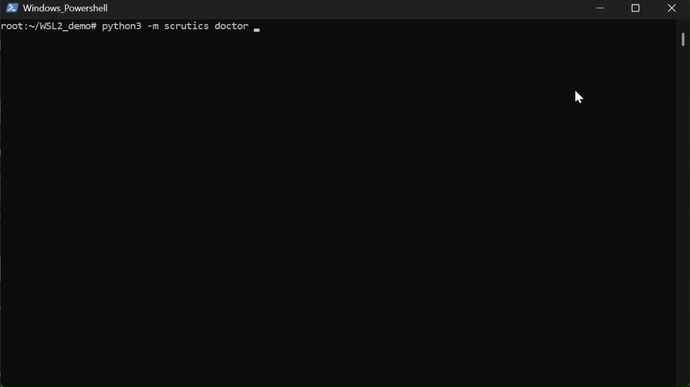

# Scrutics

**Passive OT/ICS network asset discovery : zero packet injection.**

[](https://opensource.org/licenses/MIT)
[](https://www.python.org/downloads/)



Scrutics discovers the devices on an industrial network by observing its traffic passively, and classifies each one as OT, IT or Unknown from the evidence it observed. It never transmits packets to, or interacts with, the monitored devices.

What Scrutics does and does not do, in full: [docs/SCRUTICS.md](docs/SCRUTICS.md).

---

## Why passive?

Active scanning can disrupt sensitive or legacy OT devices, particularly in environments where devices were not designed to handle unexpected traffic. Scrutics operates exclusively in read-only mode: it listens to traffic already on the wire and classifies what it sees.

No probes. No injected packets. No active interaction with monitored devices.

Before a capture starts, Scrutics replaces Scapy's send functions with a guard: a call to one raises a `PermissionError` and is logged to `output/scrutics_passive_audit.log`. The guard covers those Scapy functions only; Scrutics' capture code has no other way to send. The only network connections Scrutics opens are ones you configure or start: SIEM sinks, the AI assistant and its setup, `scrutics oui update`, and the topology page's chat.

---

## Features

- **Passive live discovery** : captures traffic from a network interface
- **PCAP / PCAPNG analysis** : works offline with existing packet captures
- **OT/ICS protocol identification** : recognises industrial services by port (33 OT ports, including Modbus TCP, S7comm, EtherNet/IP, DNP3, IEC 60870-5-104 and BACnet/IP); Modbus TCP is also validated by parsing its messages
- **Vendor identification** : MAC OUI lookup using the bundled OUI database
- **Behavioral baselining** : learns per-device communication patterns and detects anomalies (`NEW_PEER`, `DIRECTIONALITY_CHANGE`, `INTERVAL_ANOMALY`)
- **Custom behavioral rules** : constraints such as `never_initiates`, `allowed_peers`, `allowed_ports`, `max_new_peers_per_hour`
- **Interactive topology HTML** : force-directed graph with isolated-node side panel, drag, and zoom
- **Excel export (`.xlsx`)** : client-side export from the topology HTML (Assets, Connections, Summary)
- **SIEM forwarding** : anomalies to syslog (JSON, CEF, LEEF, plain) and Splunk HEC, best effort
- **Zeek & Suricata log ingestion** : discover assets from existing Zeek and Suricata logs
- **Periodic checkpoints** : session files rewritten every 15 seconds; events and anomalies appended as they happen
- **AI assistant** : ask questions about captured sessions using natural language. Supports Gemini, OpenAI, Anthropic, and Ollama (local/offline)
- **MAC-based asset identity** : persistent device tracking by MAC address with IP history
- **Passive DHCP enrichment** : extracts hostname and vendor class from observed DHCPv4 traffic
- **OUI database management** : `scrutics oui status|update|import` with air-gapped workflow support

---

## Installation

**Recommended : virtual environment**

```bash
git clone https://github.com/AhmedQazafy/Scrutics-Lightweight-OT-ICS-asset-discovery-and-industrial-network-visibility-tool.git
cd Scrutics-Lightweight-OT-ICS-asset-discovery-and-industrial-network-visibility-tool
python3 -m venv .venv
source .venv/bin/activate
pip install -r requirements.txt
```

**Editable install** (development / contributors)

```bash
pip install -e .
scrutics --version
```

**Verify everything works**

```bash
python3 -m scrutics doctor
```

Doctor checks dependencies, interfaces, and configuration. If it reports that everything looks good, you’re ready.

> On externally-managed Python environments (some Debian/Ubuntu systems) you may need `--break-system-packages`. Prefer a virtual environment whenever possible.



---

## Quick start

**Launch the TUI** (recommended for first use)

```bash
sudo python3 -m scrutics
```

**Headless live capture**

```bash
sudo python3 -m scrutics --live <interface> --headless
```

**Analyze a PCAP file**

```bash
python3 -m scrutics --file capture.pcap --headless
```

**Fast inventory from a large PCAP** (skip the learned baseline)

```bash
python3 -m scrutics --file big.pcap --headless --no-baseline
```


*Headless live capture | periodic asset snapshots with confidence scores climbing as evidence accumulates, then a clean save on Ctrl+C*

---

## Topology & Excel export

Scrutics generates an interactive HTML topology map:

- Force-directed layout
- Devices with no drawn connection listed in a side panel
- Labels hide when zoomed out to avoid clutter
- Drag nodes to adjust layout; scroll to zoom



### Export to Excel

The HTML topology includes an **Export to .xlsx** button that downloads a spreadsheet with three sheets:

- **Assets** : IP, MAC, vendor, protocol, role, confidence
- **Connections** : source, destination, protocol, packet count
- **Summary** : network statistics

The export is 100% client-side : no data is sent to any server. The SheetJS library is bundled locally so no internet connection is required.

> **Note:** Very large graphs may become slower to render.

---

## AI assistant

Scrutics includes an optional AI assistant that can answer questions about captured sessions using natural language. It needs the optional `requests` package, which `requirements.txt` does not install: `pip install -e ".[ai]"`.

**CLI**

```bash
python3 -m scrutics ask --session output/scrutics_20260914_120000
```

**TUI** : press the AI Assistant button in the toolbar.

**Supported providers** : Ollama (local, offline), Google Gemini, OpenAI, Anthropic. Configure with the built-in setup (`scrutics ai --reconfigure`, the TUI, or the setup scripts in `scrutics/config/`), or edit `~/.scrutics/ai.yaml` by hand; `scrutics/config/ai.yaml` is the packaged template.

**Default models** : `gemini-3.8-flash`, `gpt-6-luna`, `claude-haiku-5-5`, `qwen3.5:4b` (Ollama). Setup lists the models your key can use. For OpenAI it offers only `gpt-6-luna` and `gpt-6-sol`, the models whose tool calls work on the Chat Completions API that Scrutics uses. If the list cannot be fetched, setup says why and shows a fallback list marked as such. A model you name in `ai.yaml` is used as given; Scrutics sends it a temperature only if it is documented to accept one.

**Answer length** : Gemini requests allow 8192 output tokens (with a low thinking level on `gemini-3.8-flash`, since thinking counts toward the limit) and Anthropic requests 4096; OpenAI and Ollama requests carry no limit. Set `max_tokens` in `~/.scrutics/ai.yaml` to change it; setup does not write one, and a value of exactly 1024 (what earlier setups wrote) is read as the default. The model is told the answer length that fits, and an answer that still reaches the limit is shown with a notice that it was cut off.

**Follow-up questions** : each question is sent with the conversation so far, capped at the 5 most recent exchanges and 8,000 characters of their text. The newest exchange is always included; an answer longer than that keeps its start and end, with the middle marked as omitted. Older exchanges that no longer fit are left out whole. In the TUI the conversation stays when you close and reopen the assistant, and starts again when you switch session; it is not saved when Scrutics exits.

**Where setup keeps your key** :
- Linux, macOS and WSL: `scrutics ai` setup, the TUI setup and `scrutics/config/scrutics_ai_setup.sh` store the key in `~/.scrutics/ai_keys.sh`, readable only by you (mode 0600), rewritten whole each time you set up a provider. `~/.bashrc` gets one line, marked `# Scrutics AI keys`, that loads that file in new terminals; it is added once. Scrutics never edits or removes any other line of `~/.bashrc`. If it finds `export GEMINI_API_KEY=`, `OPENAI_API_KEY=` or `ANTHROPIC_API_KEY=` lines it did not write (they may hold an old key, including lines written by earlier Scrutics versions), it tells you their line numbers so you can remove them. To remove a key, delete its line from `~/.scrutics/ai_keys.sh`, or delete the file and the marked `~/.bashrc` line.
- Windows: `scrutics_ai_setup.bat` asks for the key without showing it and saves it as a variable for your Windows account only. If the variable already exists, it asks before replacing it. Open a new terminal afterwards. If a Windows policy blocks the PowerShell helper, the script says so and how to add the variable yourself (System Properties > Environment Variables, User variables). To remove the key, delete the variable under *Edit environment variables for your account*. Setup run from `scrutics ai` on Windows keeps the key for that session only and points to the `.bat`.
- The key is never put on a command line or into a script's code, where other users of the machine could see it.

**Another provider for one run** : `scrutics ai --provider openai` (also with `--diagnose`) uses that provider's own key, read from its environment variable (`GEMINI_API_KEY`, `OPENAI_API_KEY` or `ANTHROPIC_API_KEY`; Ollama needs none), and that provider's default model unless `--model` is given. The configured key, model and base URL are never passed to a different provider; of the other settings only `max_tokens` carries over, and timeout and temperature take that provider's defaults. If the variable is not set, Scrutics stops before sending anything and names the variable to set.

**Retries** : when a provider answers HTTP 429, 502, 503 or 529, or cannot be connected to, the assistant and the topology chat retry up to 4 attempts, waiting at most 30 seconds at a time and 60 seconds in total. A provider's `Retry-After` is honoured within those limits. Timeouts after the request was sent and HTTP 500, 504 and 408 are not retried, so a reply is never generated twice.

**Keys on the command line** : `list-models PROVIDER --key KEY` puts the key on the command line, where other users of the machine can see it while the command runs (for example with `ps`) and where your shell history keeps it. Prefer setting the provider's environment variable, which `list-models` reads when `--key` is not given.

**Keys in output and logs** : Scrutics sends each key only to its own provider, in a request header, and removes keys from every message it prints or raises, including Python logging at DEBUG level. One limit remains: if you turn on Python's low-level HTTP debug output yourself (`http.client.HTTPConnection.debuglevel`), Python prints every request header, including the key. Scrutics never turns it on.

**Incomplete sessions** : if part of a session cannot be read (for example a damaged `evidence.json` or a file that is not UTF-8), `scrutics ai` and the TUI assistant say which file and why, and the assistant is told that its answers cover only the part that was loaded.

The AI assistant only reads session data; it never modifies assets or injects packets. Your questions, and the session data the assistant looks up to answer them, are sent only to the provider you configured (for Ollama, your own server). The topology page's chat sends the key from your browser straight to the provider you pick and never stores it.

**What the topology chat sees**: a summary of the page, not the session. It has the asset counts by type, and the address, vendor, protocol and confidence of up to 20 OT devices. IT devices are listed by address only (just counted when there are more than 10), unknown devices are only counted, and connections are listed only when there are 15 or fewer. It is given no device roles and no vendors of IT or unknown devices, so it cannot answer questions about them; use `scrutics ai` or the TUI assistant, which look up the whole session.

Note: an Ollama server can run on another machine on the network; set its address as `base_url` in `~/.scrutics/ai.yaml`.


*The AI assistant runs in both the CLI and the TUI; `topology.html` has its own chat panel, which sees only a summary of the page.*

---

## Output files

All output is saved under `output/scrutics_TIMESTAMP/`.

| File              | When written             | Contents                                              |
|-------------------|--------------------------|-------------------------------------------------------|
| `assets.csv`      | Every 15s / session end  | IP, MAC, vendor, protocols, role, class, confidence, classification reason, per-device limit counts |
| `evidence.json`   | Every 15s / session end  | Evidence records, keyed by IP address                 |
| `manifest.json`   | Every 15s / session end  | What was observed, exported and dropped               |
| `events.csv`      | As each event happens    | Classification events (`timestamp,message`)           |
| `anomalies.csv`   | As each anomaly happens  | Behavioral anomalies (`timestamp,ip,type,severity,detail`) |
| `connections.csv` | Every 15s / session end  | Source, destination, protocol, packet count           |
| `topology.json`   | Every 15s / session end  | Machine-readable graph data                           |
| `topology.html`   | Every 15s / session end  | Interactive topology map                              |

`events.csv` and `anomalies.csv` are appended record by record and never rewritten, so they hold
every event and anomaly of the session. The other files are rewritten in place at each checkpoint;
only `manifest.json` is replaced atomically, so a process killed while a file is being written can
leave that file incomplete. `manifest.json` states, for events, anomalies, evidence,
connections and topology edges, how many were observed, exported and dropped (with the reason),
lists any write error, and sets `export_complete` to true only when nothing is missing from the
final files. `topology.json` and the topology page show the 2,000 busiest connections;
`connections.csv` lists all of them. `evidence.json` lists evidence by IP address, so when two
devices share an address only one device's evidence is written; the manifest counts the others.

### Per-device limits

Each device keeps a bounded amount of history, so a flood from one host cannot grow its record
without limit. What is not kept is counted, and the counts are appended to `assets.csv` (0, or empty
for the breakdown, when nothing was dropped) and shown in the run summary:

| Kept per device | Limit | Count column in `assets.csv` |
|---|---|---|
| IP address history | the most recent 256 changes | `ip_history_dropped` |
| Evidence values of each kind (for example mDNS names, DHCP host names) | the first 64 distinct values | `evidence_overflow`, per kind in `evidence_overflow_by_type` |
| DNS names | the first 64 | `dns_names_overflow` |
| Peer addresses (`peer_count` is the number kept) | the first 4096 | `peer_additions_rejected`, every refused addition including repeats |
| First-contact times for `max_new_peers_per_hour` | the first 4096 peers | `peer_first_seen_overflow` |

A peer beyond the 4096th is not reported as a new peer by the behavioral baseline and does not count
toward `max_new_peers_per_hour`; it still appears in the topology.

---

## Configuration

Edit `scrutics/config/custom_rules.yaml` to add custom rules and SIEM sinks. Changes reload automatically while Scrutics is running. Press `R` in the TUI for an immediate reload.

The built-in ICS rules are in `scrutics/config/builtin_rules.yaml` : do not edit this file.

**Custom classification + behavioral rule**

```yaml
rules:
  - name: "Modbus PLC Fleet"
    port: 502
    mac_prefix: "00:80:F4"      # the PLCs' vendor prefix
    classify_as: "Modbus TCP"
    role: "PLC / RTU"
    is_ot: true
    never_initiates: true
    allowed_peers:              # every host that talks to these PLCs (SCADA server, HMI)
      - "192.168.1.100"
      - "192.168.1.50"
    max_new_peers_per_hour: 2
```

A rule's fields must all match: this rule applies to devices that serve port 502 and whose MAC
starts with `00:80:F4`. Put behavioral constraints only in rules that also set `mac_prefix`. A
device that contacts a port (for example an HMI or SCADA server polling port 502) also receives
the constraints of a rule for that port unless the rule's `mac_prefix` excludes it, so a constraint
rule with `port` alone raises alerts for every client that polls the PLCs. List in `allowed_peers`
every host that talks to the devices; any other peer raises an alert.

**SIEM sink**

```yaml
output:
  sinks:
    - type: syslog
      host: 192.168.1.50
      port: 514
      protocol: udp
      format: json        # json | cef | leef | plain

    - type: splunk_hec
      url: "https://splunk.example.com:8088"
      token: "your-hec-token"
      verify_ssl: true
```

Classification fields: `name`, `port`, `mac_prefix`, `protocol`, `classify_as`, `role`, `is_ot`, `confidence`

Behavioral constraints: `never_initiates`, `allowed_peers`, `allowed_ports`, `alert_on_new_port`, `max_new_peers_per_hour`

---

## Deployment notes

**Finding the right interface**

```bash
python3 -m scrutics doctor
sudo tcpdump -i <interface> -c 10
```

If `tcpdump` shows no packets, the interface is wrong or the SPAN/mirror port is not configured.

**Supported capture types**

Devices are built from Ethernet frames carrying IPv4 or ARP, so capture on a named Ethernet
interface (`--live eth0`, or `tcpdump -i eth0 -w capture.pcap` for a file). These are not
supported and produce no devices:

- Linux cooked captures (SLL and SLL2), which `tcpdump -i any` writes; do not capture on the `any`
  pseudo-interface
- raw-IP captures with no link layer
- IPv6 traffic

The run summary counts such frames by kind, and a capture that produces no devices says why.

**Windows users**

Live capture requires Linux or WSL2. Clone inside the WSL filesystem (not `/mnt/c/...`) or analyze offline PCAP files. Offline PCAP analysis does not require root privileges.

**Stopping a live capture**

Run live captures in the foreground so Ctrl+C can stop the capture cleanly:

```bash
sudo python3 -m scrutics --live <interface> --duration 0 --headless
# Ctrl+C stops the capture and flushes the current session data
```
---

### Example GIF

*Using Doctor then Headless live test then a save on Ctrl+C*

---

## Command reference

| Option               | Default    | Description                                      |
|----------------------|------------|--------------------------------------------------|
| `--live INTERFACE`   | :          | Network interface for live capture               |
| `--file FILEPATH`    | :          | File to analyze (`.pcap`, `.pcapng`, `.log`, `.json`) |
| `--duration SECONDS` | 60         | Capture duration. `0` = run until Ctrl+C         |
| `--baseline SECONDS` | 60         | Observation window before anomaly detection      |
| `--output DIR`       | `./output` | Output directory for session folders             |
| `--headless`         | off        | Run without the TUI                              |
| `--no-baseline`      | off        | Skip the learned baseline; rule, identity and Suricata alerts still run |
| `doctor`             | :          | Print diagnostic information                     |
| `ai`                 | :          | AI assistant (alias: `ask`)                      |
| `oui status`         | :          | Show OUI database status and freshness           |
| `oui validate FILE`  | :          | Check an OUI database file                       |
| `oui update`         | :          | Download latest OUI database from IEEE            |
| `oui import FILE`    | :          | Import an offline OUI database file               |
| `list-models PROVIDER`| :         | List available models for a provider              |

**TUI shortcuts:** `1` Start · `2` File Options · `3` Toggle Panels · `R` Reload Rules · `P` Pause · `A` AI Assistant · `Q` Quit · `←→` Switch Panels · `Enter` Scroll Mode

---

## Troubleshooting

Run `python3 -m scrutics doctor` first : it identifies most issues.

| Symptom                 | Fix                                                                 |
|-------------------------|---------------------------------------------------------------------|
| No packets after 30 s   | Wrong interface : check doctor interface list                       |
| Permission denied       | `sudo python3 -m scrutics`                                          |
| `assets.csv` not saved  | Process was backgrounded : run in the foreground and use Ctrl+C     |
| Rules not reloading     | Check YAML syntax and run `scrutics doctor`; inspect console output |
| TUI won't open          | `pip install textual` (inside your virtual environment)             |

---

## Known limitations

- Large PCAPs may require more processing time and memory. Use `--no-baseline` when behavioral anomaly detection is not required.
- Memory grows with the number of distinct devices seen; there is no limit on the number of devices. Spoofed traffic that invents many MAC or IP addresses therefore grows memory without bound. Measured with the behavioral baseline on: about 9 KB per device that talks to one other host (about 880 MB per 100,000 invented devices), plus about 1 KB for each further host a device talks to (19 KB per device with ten); the connections between devices are kept without a limit. With `--no-baseline` a device talking to one host takes about 7 KB. The history kept per device is bounded (see "Per-device limits"), but the behavioral baseline is kept per IP address, so one device that moves through many addresses still adds one baseline per address.
- Live capture loses packets it cannot keep up with, and does not count them; the loss rate was not measured in v0.7
- Hosts behind a router are recorded against the router's MAC address
- Confidence is the accumulated weight of a device's evidence, capped at 100: it measures how much evidence there is (an OT vendor alone gives 30), not how likely the class is to be right
- Protocols other than Modbus TCP are identified by port number only; no device is classified Infrastructure
- No MAC addresses in Zeek/Suricata logs : OUI vendor matching unavailable, and devices are identified by IP address. Their application-layer logs (`modbus.log`, `dnp3.log`, Suricata `modbus` events) are used only as observations of the protocol's port
- No IPv6 support
- No Linux cooked (SLL/SLL2, `tcpdump -i any`) or raw-IP captures: see "Supported capture types"
- Topology groups of more than 30 devices or 60 links keep the force layout and can show crossing connections; a protocol label that does not fit beside its connection is not shown
- WSL2 file performance : keep Scrutics on the Linux filesystem, not `/mnt/c/...`
- Very large topology graphs may become slower to render

---

## Why v0.x?

Scrutics stays in the 0.x series while validating its architecture through real-world deployments. Core capture and classification are functional and covered by the project’s test suite. Configuration format and internal APIs may change before v1.0.

---

## Roadmap

- Validate Wazuh and Splunk integrations in production environments
- Improve Windows and offline PCAP workflows
- Refine behavioral detection based on feedback from real OT environments
- Explore Gephi / Cytoscape import for advanced graph analysis
- Investigate standalone executable packaging

---

## Project structure

```text
Scrutics/
├── scrutics/
│   ├── baseline/       – behavioral baseline engine
│   ├── capture/        – packet capture and flow processing
│   ├── classifier/     – OUI lookup and protocol classification
│   ├── config/         – YAML rules (builtin_rules.yaml, custom_rules.yaml)
│   ├── db/             – asset inventory and rolling CSV writer
│   ├── diagnostics.py  – health checks (scrutics doctor)
│   ├── integrations/   – SIEM sink manager (syslog, Splunk HEC)
│   ├── parsers/        – Zeek, Suricata and Modbus TCP parsers, file type detection
│   ├── signals.py      – file-watch reload and SIGHUP handler
│   ├── ui/             – Textual TUI
│   └── passive.py      – passive enforcement layer
├── sim/                – Docker OT simulation (Modbus, EtherNet/IP, BACnet)
├── tests/              – test suite
└── pyproject.toml
```

## License

MIT
